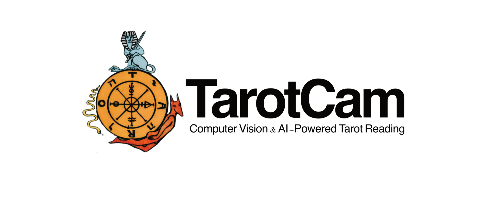
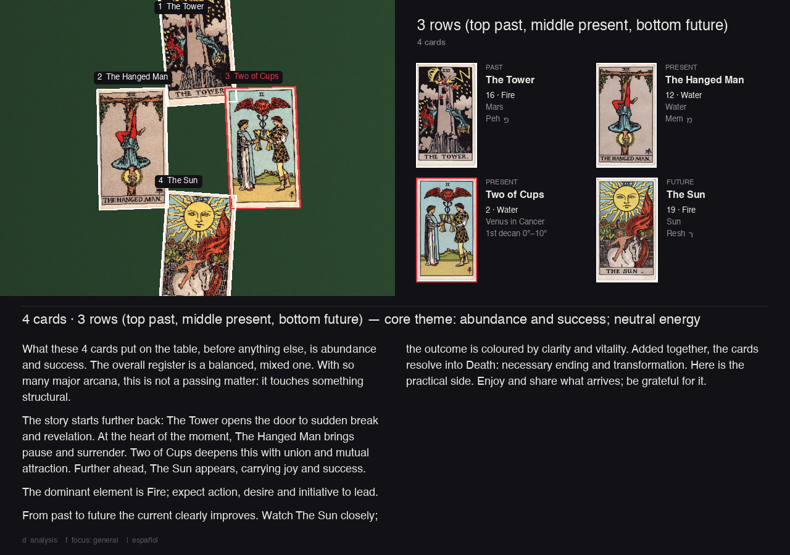
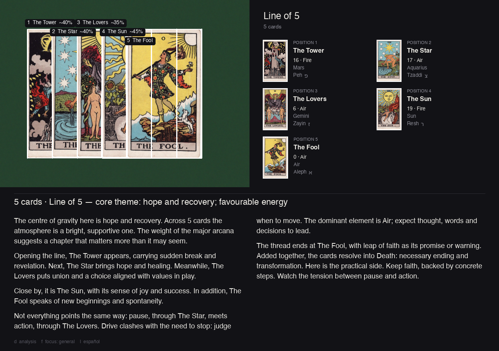
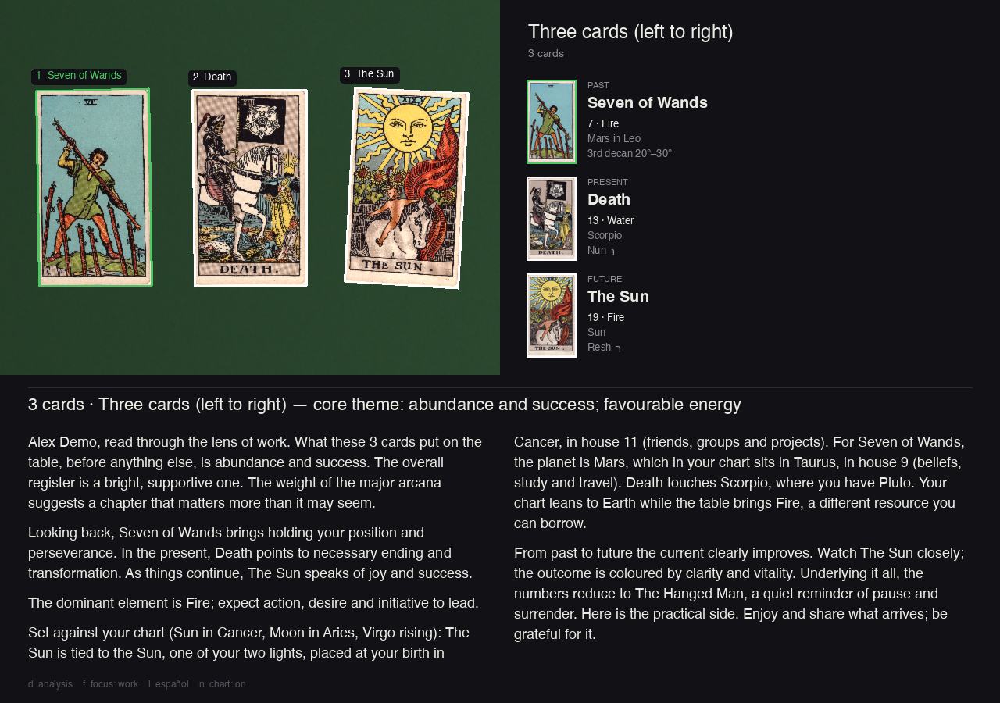
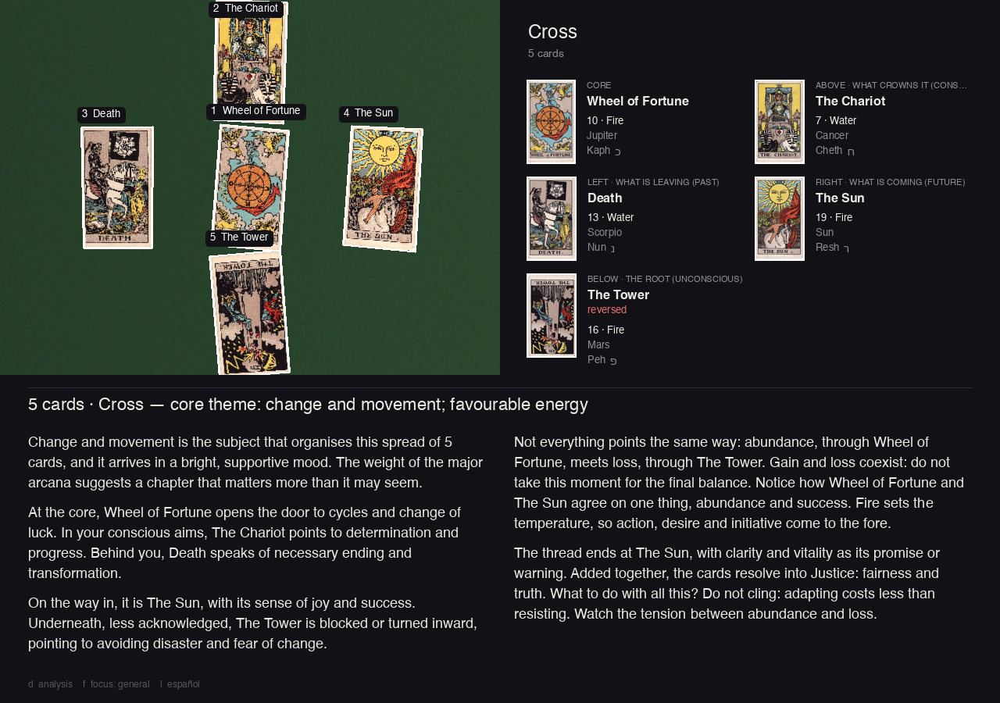
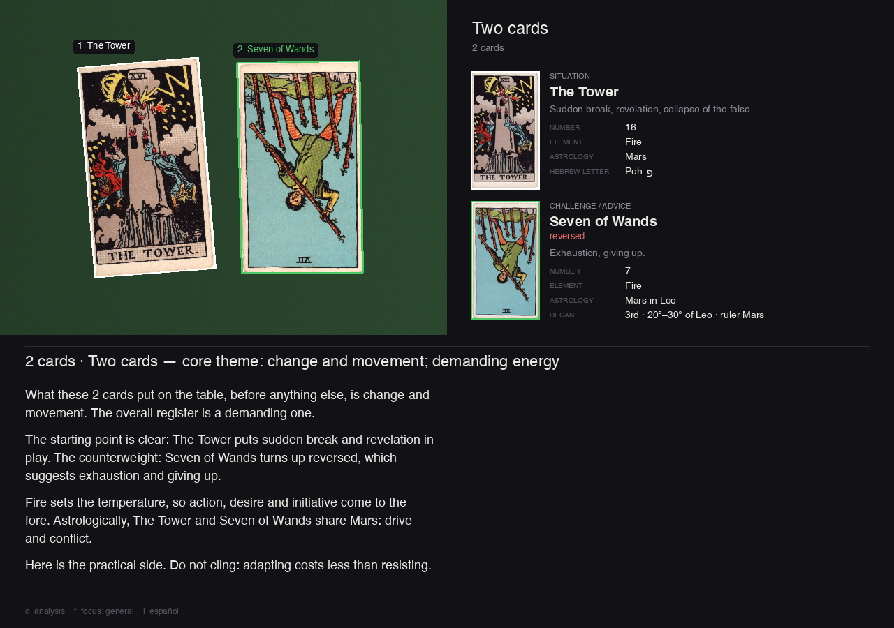
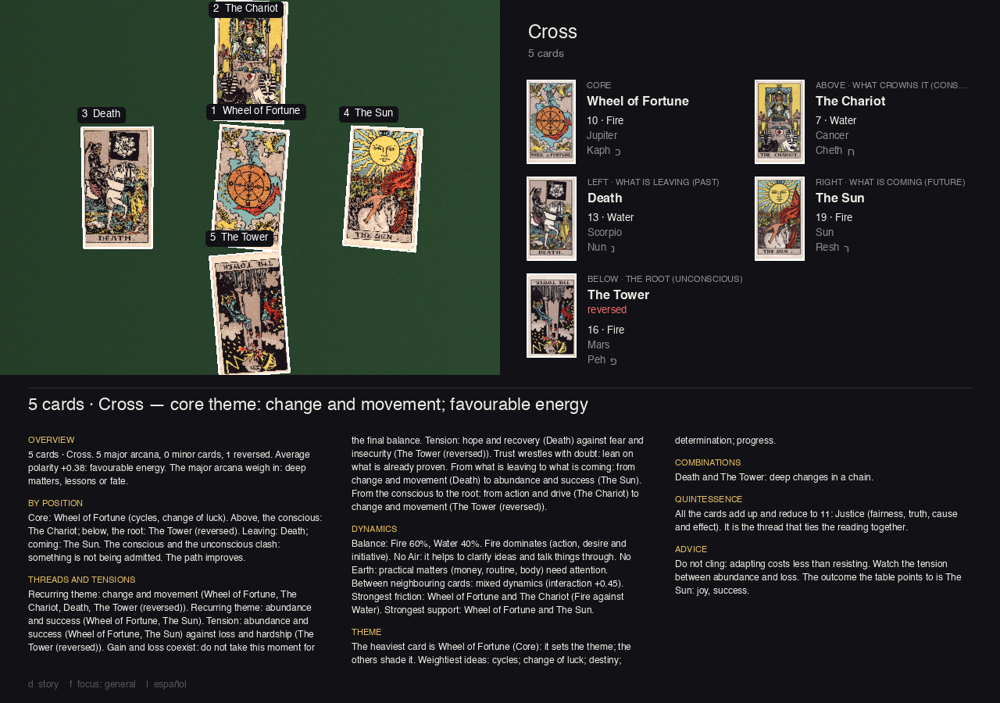
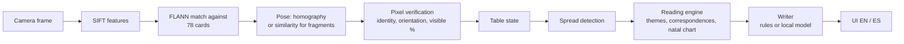

# TarotCam

<p align="center">
  
</p>

    

Lay tarot cards in front of a camera. TarotCam recognises every one of them, understands where you put them, and builds a reading that evolves with each card you add.

<p align="center">
  
</p>

---

## Highlights

- 🃏 **Two decks:** Rider-Waite-Smith and the **Tarot de Marseille**, all 78 cards, upright **and reversed**.
- 🔍 **Partially hidden cards:** a card is recognised from a fraction of its face, even in a stacked pile.
- 👀 **Many cards at once.** A card is never read twice.
- 🧭 **Position means something:** rows, Cross, Celtic Cross and Horseshoe are detected from the layout on the table.
- ✍️ **A reading written as prose,** not a list of blocks: opening, story by position, tensions, outcome and counsel, without repeating itself.
- 🎯 **Focus** the reading on love, work, money or your inner life.
- 🌌 **Optional natal chart:** enter your birth data and the cards are read against your own placements, computed offline.
- ✨ **Full correspondences** per card: number, element, astrology, Hebrew letter / decan / elemental blend.
- 🎨 **Suit-coloured frames** on the live video and a quiet, minimal interface.
- 🌍 **English and Spanish**, switchable live.
- 🔒 **Local by design.** No cloud and no API keys. Recognition is classic computer vision and the built-in writer is an explicit rule engine, so the same table gives the same reading. A local language model is optional.

## Screenshots

> Rendered by the real program on **simulated** table images (real card scans composited with perspective, blur and noise).

### Partially hidden cards



### Your natal chart in the reading



*The person in this example is fictitious.*

### Cross spread: five cards, five roles



### Card correspondences



### Section-by-section analysis (press `d`)



## Quick start

Tested on macOS (Apple Silicon) with Python 3.12.

```bash
git clone https://github.com/AlejoMalia/tarotcam.git
cd tarotcam
python3.12 -m venv .venv && source .venv/bin/activate
pip install -r requirements.txt
python -m tarotcam.tools.download_deck            # fetches the 78 reference cards (~16 MB) from Wikimedia Commons
python -m tarotcam.tools.fetch_datasets           # optional: three open tarot datasets (~0.3 MB)
python -m tarotcam --camera 0  # live, using your webcam
```

No camera at hand? Analyse a picture:

```bash
python -m tarotcam --image table.jpg --save reading.png
```

### Controls

| Key | Action |
|---|---|
| `t` | deck: Rider-Waite-Smith ⇄ Marseille |
| `d` | story ⇄ section-by-section analysis |
| `f` | focus: general → love → work → money → inner life |
| `l` | English ⇄ Español |
| `n` | natal chart on / off (if you saved one) |
| `a` | local model on / off (with `--writer local`) |
| `r` | reset the table |
| `s` | save a screenshot |
| `q` | quit |

### Options

| Option | Meaning |
|---|---|
| `--camera N` | OpenCV camera index |
| `--deck rws\|marseille` | deck on the table (default `rws`) |
| `--image FILE` / `--save FILE` | analyse a still picture / save the rendered result |
| `--lang en\|es` | interface language (default `en`) |
| `--spread auto\|rows\|line\|cross\|celtic\|horseshoe\|entry` | how to read the layout (default `auto`) |
| `--focus general\|love\|career\|money\|spiritual` | area of life |
| `--detail` | start with the analysis view |
| `--setup-chart` / `--no-chart` | enter your birth data / ignore the saved chart |
| `--writer rules\|local` | built-in writer (default) or a local language model |
| `--model NAME` / `--llm-url URL` | local model name and endpoint |

## Tarot de Marseille

```bash
python -m tarotcam.tools.download_deck --deck marseille
python -m tarotcam --camera 0 --deck marseille
```

- French card names, traditional printed numbers (**Justice is VIII, Strength XI**, XIII has no name, Le Mat has no number).
- Pip cards are read as the idea of their number applied to their suit; trumps and court cards traditionally.
- No Hebrew letters, planets or signs are shown: those attributions belong to other traditions. The engine still uses one element per card for its elemental balance.
- Reference images, from Wikimedia Commons: [CBD Tarot de Marseille](https://commons.wikimedia.org/wiki/Category:Tarot_de_Marseille_-_Yoav_Ben-Dov) by Yoav Ben-Dov (CC BY 3.0) and [Jean Dodal, c. 1701–1715](https://commons.wikimedia.org/wiki/Category:Tarot_de_Marseille_-_Jean_Dodal) (public domain, BnF). Commons limits download speed: if some images fail, wait a while and run the command again; it resumes. A deck is used once its 78 images are present.
- Recognition has only been spot-checked on the major arcana. Marseille pip cards look alike and are nearly symmetrical, so expect lower accuracy and unreliable orientation on them.

## Your natal chart (optional)

```bash
python -m tarotcam.astro.natal            # asks name, date, time and birthplace
python -m tarotcam.astro.natal --show     # print the chart
python -m tarotcam.astro.natal --delete   # remove your data
```

- Computed **entirely on your machine** with [PyEphem](https://rhodesmill.org/pyephem/) and an offline city list. No birth data is sent anywhere.
- Saved to `~/.tarotcam/profile.json` (readable only by you), outside the project folder.
- Tropical zodiac, Sun to Pluto, Ascendant, Midheaven, whole-sign houses, historical daylight saving time.
- Without a birth time there is no Ascendant or houses, and the Moon is treated as approximate.
- In the reading, each card is checked against your chart: a natal point inside the card's own **decan**, your Sun / Moon / Rising sign, the placement of the card's planet, and how the table's dominant element compares with yours.

`tests/test_natal.py` checks the astronomy against independent facts (the Sun at the equinoxes, on the Ascendant at sunrise and on the Midheaven at noon).

## The writer

The default writer composes prose from the engine's analysis. Phrasing varies between tables but is deterministic, and no sentence repeats within a reading.

**Optional local model.** Any OpenAI-compatible server on your own machine (for example [Ollama](https://ollama.com) or LM Studio) can rewrite the reading:

```bash
ollama pull qwen2.5:3b
python -m tarotcam --camera 0 --writer local --model qwen2.5:3b
```

Only loopback addresses are accepted. The model receives the facts of the table (and your chart, if enabled) and, while it writes or if it fails, the built-in text is shown. The connector is tested against a mock server; the quality of the prose depends on the model you choose.

## Spreads

"Top" means the top of the camera image.

| Layout on the table | How it is read |
|---|---|
| **3 rows**, any number of cards per row | top = Past, middle = Present, bottom = Future, with a trend between them |
| 2 rows | top = Situation, bottom = Outcome |
| 1 row of 3 cards | left to right: Past, Present, Future |
| **Cross** (centre + one on each side) | core, above (conscious), below (root), left (leaving), right (coming) |
| **Celtic Cross** (6-card cross + column of 4, second card lying across) | the ten classic positions, with the outcome |
| **Horseshoe** (7 cards in a U) | seven positions ending in the outcome |
| Anything else | rows or a line; `--spread entry` reads by order of arrival |

A 5-card layout shaped 1-3-1 is read as a Cross. To read it as three rows, use `--spread rows`.

## The analysis

Every time the table changes, the whole reading is recomputed. Press `d` to see the sections behind the story:

| Section | What it looks at |
|---|---|
| **By position** | what each card means in its role |
| **Threads and tensions** | themes shared by several cards, opposing themes present together, and how the theme shifts between linked positions |
| **Shared correspondences** | planets and signs that appear on more than one card |
| **Your chart** | contacts between the cards and your natal placements (when enabled) |
| **Dynamics** | weighted elemental balance, imbalances, elemental dignities between neighbouring cards |
| **Theme**, **Combinations**, **Quintessence**, **Advice** | heaviest card, classic pairs and repeated numbers, the numeric essence, counsel |

**Weights:** major arcana ×1.8, court cards ×1.4, reversed ×0.65, times a position weight.
**Themes:** 22 themes with 9 opposing pairs (beginnings ↔ endings, change ↔ stability, action ↔ pause, clarity ↔ confusion…).

## Frame colours

| Card | Colour |
|---|---|
| Major arcana | ⬜ white |
| Pentacles | 🟨 egg-yolk yellow |
| Swords | 🩵 sky blue |
| Wands | 🟩 green |
| Cups | 🟥 red |

## Correspondences

Golden Dawn / Rider-Waite-Smith attributions.

| Card | Astrology | Extra |
|---|---|---|
| Major arcana | planet or sign (modern: Uranus, Neptune, Pluto) | Hebrew letter |
| Aces | root of the element | the element's three signs |
| Pips 2–10 | planet in sign | decan, degrees and ruler |
| Court cards | zodiac span (Pages have none) | elemental blend: Page = Earth, Knight = Air, Queen = Water, King = Fire, of the suit |

The tests check that the 36 decans cover each sign three times and follow the Chaldean order of rulers, and cross-check letters and decans against the independent StarTarot dataset (58 attributions, no differences). Other traditions (e.g. Thoth) differ in some attributions.

## How it works



- **Recognition** searches the whole frame for all cards at once, without relying on card outlines. When only a fragment shows, a more rigid pose is estimated and the reference is compared block by block with the frame, which rejects false matches and estimates how much is visible.
- **One card, one reading:** a deck has no duplicates, and two cards cannot explain the same pixels.
- **Language independence:** the engine reasons over one canonical representation; language only changes the text.

## Performance

Measured on **simulated** 640×480 frames, Apple Silicon.

**Part of a card visible** (`partial_test.py`, 156 trials per row):

| Visible | Correct (identity + orientation) | False cards |
|---|---|---|
| 50 % | 100 % | 0 |
| 30 % | 99 % | 0 |
| 20 % | 92 % | 0 |
| 15 % | 79 % | 0 |
| 10 % | 42 % | 0 |

In a two-card stack where the lower card shows only 20 %, it was found in 97 % of cases. No false cards appeared in 200 scenes without cards.

**Whole cards** (`scale_test.py`): 100 % with 1–8 cards, 94 % with 10, 90 % with 12, no false positives; about 150–180 ms per scan.

Simulation uses the same artwork as the reference deck, so **your physical deck, paper, glare and lighting will affect real results**. Small fragments need detail: a plain patch of sky cannot be identified.

**For best results:** a matte, plain background; good even light; cards as large in the frame as possible.

## Data sources

`tarotcam.tools.fetch_datasets` downloads three open datasets, pinned to reviewed commits, into `data/datasets/` (not included in this repository). Their texts are in English and feed the focus sentences, Golden Dawn titles and cross-checks.

| Dataset | Licence |
|---|---|
| [Tarotoo-com/tarotoo-tarot-dataset](https://github.com/Tarotoo-com/tarotoo-tarot-dataset) | MIT |
| [smallcat419/tarot-card-data](https://github.com/smallcat419/tarot-card-data) | CC0, as stated in its README |
| [StarTarotOnline/tarot-rws-dataset](https://github.com/StarTarotOnline/tarot-rws-dataset) | CC BY 4.0 |

Without them the app works with its built-in meanings. In Spanish, focus sentences are built from the card's keywords.

## Optional knowledge base

`python -m tarotcam.tools.build_knowledge --zaiphira keywords.rtf --symbols symbols.rtf` converts your own symbolism documents into
`data/knowledge/kb.json`. When present, TarotCam uses its keywords (English and Spanish) and adds a **Shared symbols** section
for the major arcana. The folder is git-ignored: no third-party texts ship with this repository, and everything else works without it.
The parser expects the specific layout of those two documents (see the docstring in `build_knowledge.py`).

## Tests

```bash
python -m tests.run_all            # all tests
python -m tests.run_all --bench    # plus the recognition benchmarks
```

Recognition tests need the downloaded Rider-Waite-Smith deck; the Marseille recognition check runs when its images are present.

## Project layout

```
tarotcam/
  app.py          application (python -m tarotcam)
  i18n.py  paths.py
  carddata/       meanings, correspondences, decks, Marseille, optional data layers
  vision/         card recognition and table state
  engine/         spreads, analysis, writers
  astro/          natal chart
  interface/      rendering
  tools/          download and build scripts
tests/            tests, simulator and benchmarks
data/             local decks and datasets (git-ignored)
```

## Limitations

- Built and tested on **macOS**; the interface uses macOS system fonts.
- Recognition targets the classic Rider-Waite-Smith artwork. Other decks need their own reference images in `deck/`.
- The built-in reading is composed from rules and phrase banks. It is meant for reflection and entertainment, not as prediction or as medical, legal or financial advice.

## Credits

- Rider-Waite-Smith deck, illustrated by Pamela Colman Smith (1909); scans from [Wikimedia Commons](https://commons.wikimedia.org/).
- Tarot de Marseille: CBD edition © Yoav Ben-Dov (CC BY 3.0); Jean Dodal, scans from the Bibliothèque nationale de France.
- Correspondences following the Hermetic Order of the Golden Dawn tradition.
- Meanings and attributions: the datasets listed under *Data sources*, including **StarTarot** (CC BY 4.0).
- Astronomy: [PyEphem](https://rhodesmill.org/pyephem/) (MIT). Cities: [geonamescache](https://github.com/yaph/geonamescache) with data from [GeoNames](https://www.geonames.org/) (CC BY 4.0).
- Built with [OpenCV](https://opencv.org/), NumPy and Pillow.

## License

[MIT](LICENSE). The card images, datasets and city data keep their own licences.
